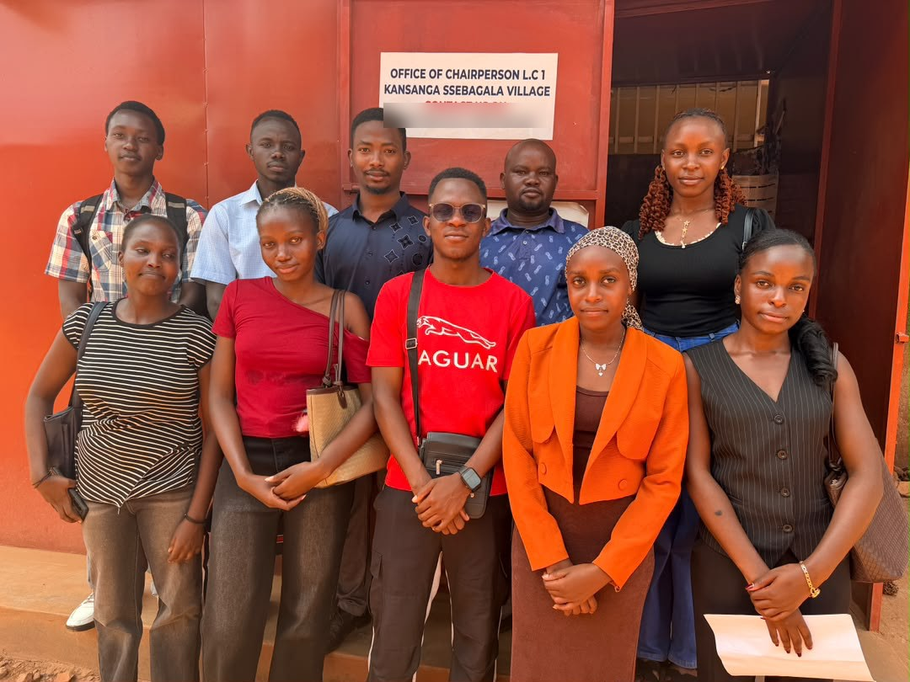

# Field study — Kansanga, Makindye Division (Kampala)

## 1. Study details

| Item | Detail |
| --- | --- |
| Date of fieldwork | 14 October 2026 |
| Location | Kansanga Ssebagala Village, Kansanga, Makindye Division, Kampala |
| Meeting point | Office of the LC1 Chairperson, Kansanga Ssebagala Village |
| Study team | Group 5: Lugemwa Andrew (team lead), Najjuma Anisha, Ochen Daniel, Ssemujju Arthur Silver, Nabakka Caroline, Nalukwago Shanitah, Obanya Julius, Aber Mercy Unia, Muroreukwere Shamirah, Nyamanyama Essenine |
| Original topic | Community noise and nuisance: a proposed *Community Noise Mapper* |
| Evidence kept | Group photograph at the LC1 office (Figure 1), audio recordings of resident interviews, video clips |

*Figure 1 — Group 5 at the office of the LC1 Chairperson, Kansanga Ssebagala Village, during fieldwork on
14 October 2026. Contact numbers on the sign have been blurred for privacy.*

## 2. Methods

| Method | Detail |
| --- | --- |
| Site visit | Visit to Kansanga Ssebagala Village, starting at the LC1 Chairperson's office |
| Interviews | Informal interviews with residents and people working in the area about noise, recorded as audio |
| Photography and video | Photographs and short video clips taken during the visit |

No written field notes were taken on the day; findings below are taken from the audio recordings.

## 3. Findings

**Interview with a woman working near bars in Kansanga** (audio recording):

- Noise in the area comes mainly from nearby bars.
- During the day the music is not loud.
- She does not live near the bars; she was interviewed at her workplace, so she could not describe
  noise at night.

**What this told us:**

1. Noise complaints are linked to **specific places** (individual bars), so a useful report must record
   *where* the problem is.
2. Noise depends on the **time of day**: it was not a problem during the day, and night-time conditions
   could not be observed by a daytime visit or described by people who only work in the area. Reports
   therefore need to be made by the affected residents themselves, at the time the problem happens,
   and must be **dated and timed**.
3. The people most affected (residents living near the bars at night) are not always reachable by
   researchers or officials during the day. They need a way to **report on their own and follow up**
   without visiting an office.

## 4. Change of scope

The project began as a *Community Noise Mapper*: a tool for mapping noise complaints. While analysing
the fieldwork, the group saw that the needs above (record the place, record the time, let residents
report and follow up on their own) apply to every kind of community complaint, not only noise. With the
lecturer's approval, the project was widened into **CivicServe**, a general community complaint
reporting and tracking system. Noise and nuisance remains a core category, listed first on the
reporting form.

The code history reflects this: CivicServe 2.x contained a separate *Noise & Nuisance Mapper* module;
CivicServe 3.0 folds it into the general system.

## 5. From findings to requirements

| Finding | Requirement | CivicServe feature |
| --- | --- | --- |
| Noise comes from specific places (bars) | Record exactly where the problem is | Location field, area selection and optional map pin (with typed coordinates if maps fail) |
| Noise depends on the time of day | Record when each complaint is made | Every report is time-stamped; full case history with dates and times |
| Affected residents are hard to reach during the day | Residents report and follow up on their own, at any time | Online report form open at all hours; reference number; public tracking page |
| Complaints must reach someone who can act | Each complaint has a responsible owner | Automatic routing of each category to a department (noise → Public Health Services & Environment) |
| Not everyone reports online | Complaints made in person or by phone are not lost | Staff "Log a complaint" page for walk-in and phone complaints |
| Residents' identities need protecting when complaining about neighbours or businesses | Personal details kept private | Tracking page shows no personal data; only authorised staff see complainants' details |
| Scope widened to all community complaints | One system for all issue types | Categories for noise, roads, drainage, garbage, street lights, building control, markets and facilities |

## 6. Limitations

- The fieldwork took place on one day, during daytime, so night-time noise was not observed.
- One interview is summarised here from the audio recordings; no written notes were taken.
- The woman interviewed works in the area but does not live near the bars.
- Issue types other than noise (roads, drainage, garbage, street lights, building control, markets)
  were not studied in the field. They were added when the scope was widened, based on common municipal
  service issues, and should be confirmed in a follow-up study.
- The departments in the system are modelled on KCCA's directorates (Engineering & Technical Services;
  Public Health Services & Environment; Physical Planning; Gender, Community Services & Production;
  Administration & Human Resource Management). CivicServe is an academic project and is not used by,
  or affiliated with, KCCA.
